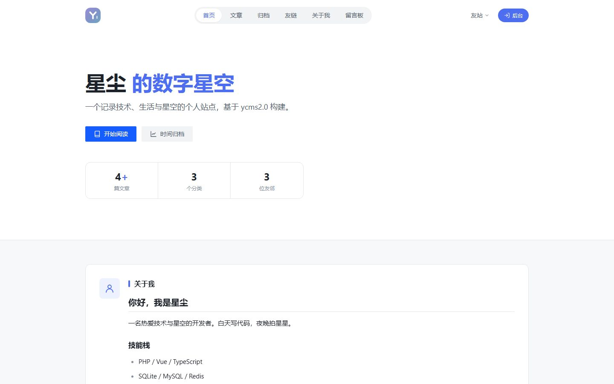
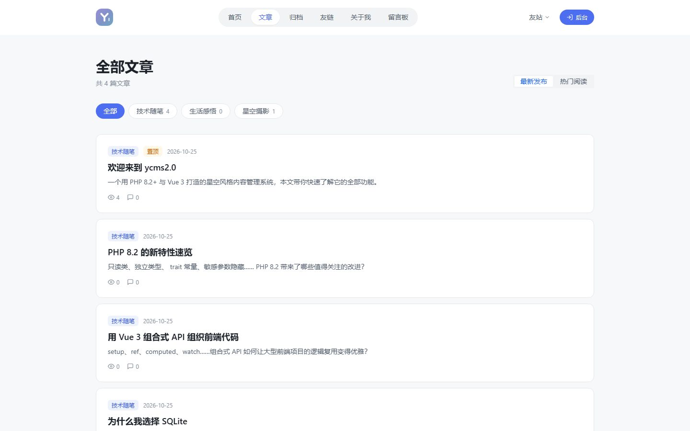
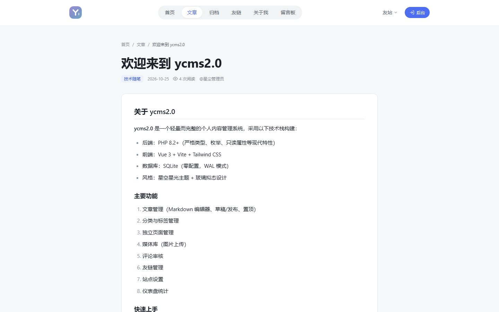
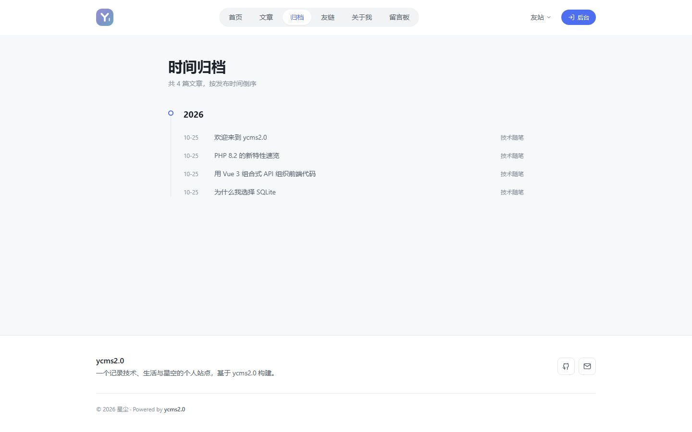
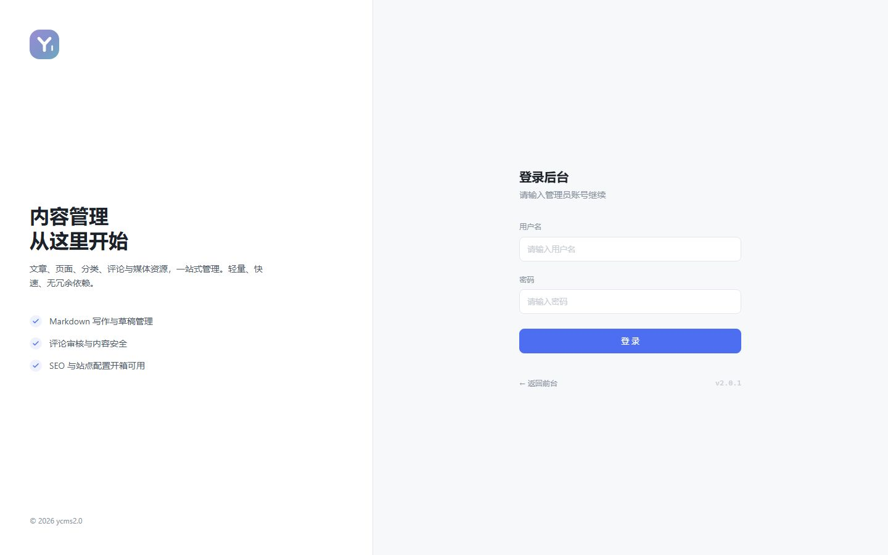
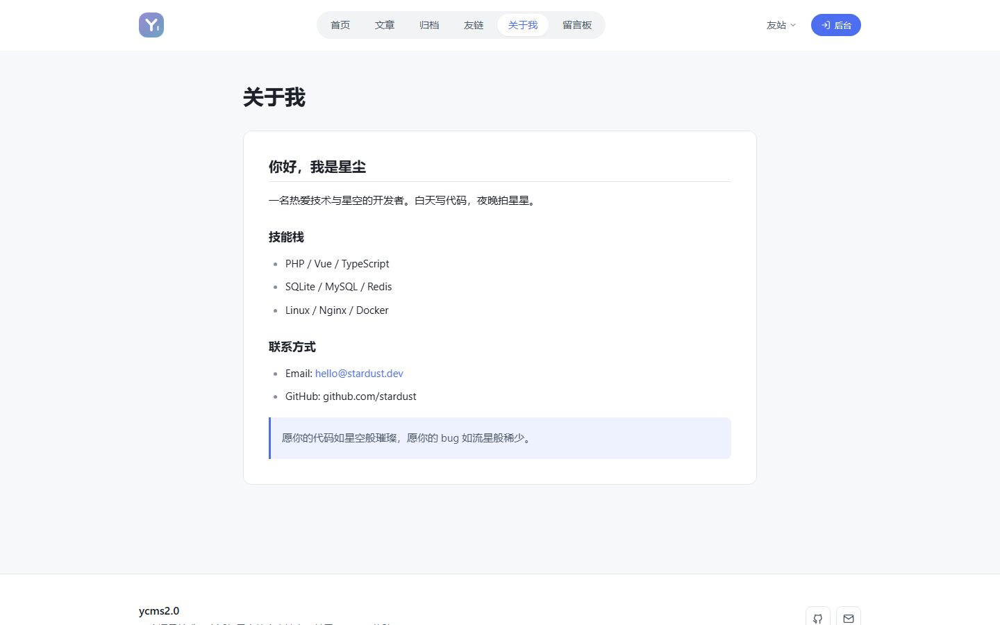

# ycms2.0

轻量内容管理系统，PHP 8.2+ / Vue 3 / SQLite 单文件数据库，开箱即用的个人博客与企业站点基座。

- **零配置部署**：站点根目录指向 `public/`，访问 `/install.php` 完成安装，无需伪静态与重写规则
- **前后台独立构建**：前台主题与后台管理面板互不影响，任一方编译失败不影响另一方
- **主题化产物**：前台输出到 `public/themes/<slug>/`，`theme.json` 声明元数据，可打包分发
- **两套 UI 体系**：通用扁平 UI（默认）与星空 UI，共享组件、独立样式文件，互不混用

## 界面预览

### 前台（通用 UI）

<table>
  <tr>
    <td></td>
    <td></td>
  </tr>
  <tr>
    <td></td>
    <td></td>
  </tr>
</table>

### 后台（登录页）

<table>
  <tr>
    <td></td>
    <td></td>
  </tr>
</table>

> 截图存放于 `docs/screenshots/`，全部使用仓库相对路径，GitHub 可直接渲染。

## 目录结构

```
ycms/
├── backend/                  # PHP 后端
│   ├── public/index.php      # 前端控制器（入口）
│   ├── src/
│   │   ├── App.php           # 应用引导与路由注册
│   │   ├── Core/             # Router / Request / Response / Database
│   │   ├── Controllers/      # REST 控制器
│   │   └── Support/          # helpers / Auth / StaticBuilder / UpdateService
│   │       └── Theme/        # ThemeManager（主题目录）/ LegacyMigrator（老站点迁移）
│   ├── database/             # schema.sql / migrate.php / seed.php
│   ├── tools/                # build-static.php / theme.php / reset-password.php
│   └── storage/              # database.sqlite / uploads（自动创建，不进版本库）
├── frontend/                 # Vue 前端（core / shared / admin / site 四层）
│   ├── core/                 # 与主题无关：api / stores / utils / router 基座
│   ├── shared/               # 通用组件与两套样式（styles/ui.css、styles/star.css）
│   ├── admin/                # 后台（独立入口，不随主题变化）
│   ├── site/                 # 内置主题源码（theme.json + 视图 + SSR 模板）
│   └── scripts/              # 构建收尾与主题打包（pack-theme.mjs）
├── public/                   # 站点运行目录（构建产物 + PHP 入口）
│   ├── index.html            # 站点根入口（主题外壳副本）
│   ├── admin/                # 后台静态产物
│   └── themes/default/       # 前台主题包结构
├── docs/                     # 文档与界面截图
├── themes.json               # 主题清单（版本 / 包名 / sha256）
├── update.json               # 在线更新清单（含 themes 摘要）
└── VERSION                   # 当前版本号
```

## 快速开始

### 生产部署（三步，无需配置 Nginx）

1. 上传整个项目到服务器，站点**根目录指向 `public/`**
2. 浏览器访问 `https://你的域名/install.php`
3. 填写站点名称与管理员账号 → 安装完成（自动建库、建管理员、生成静态页）

完成后：前台 `/`，后台 `/admin/`。详细步骤见 [部署指南](docs/deployment.md)。

> 零配置原理：API 走真实文件 `/api.php/...`，后台是静态目录 `/admin/`，
> 文章与列表页在发布时生成真实 HTML —— 全部是服务器默认行为，不需要伪静态/重写规则。

### 本地开发

```bash
# 后端（PHP 8.2+）
cd backend
php -S localhost:8080 -t public dev-router.php

# 前端（Node 18+，同时提供前台与后台两个入口）
cd frontend
npm install
npm run dev
#   前台：http://localhost:5173/
#   后台：http://localhost:5173/admin/
```

构建产物输出到项目根目录的 `public/`：

```bash
cd frontend
npm run build          # 前后台一起
npm run build:site     # 仅前台主题 → public/themes/default/，并复制为 public/index.html
npm run build:admin    # 仅后台 → public/admin/
npm run pack:theme     # 构建后打主题包 → release/themes/*.zip + themes.json
```

### 访问

| 页面 | 地址 |
| --- | --- |
| 前台首页 | http://localhost:5173 |
| 后台登录 | http://localhost:5173/admin/login |
| 默认账号 | `admin` / `admin123`（首次登录强制修改） |

## 功能清单

### 前台（主题站点）

- 首页：首屏、数据统计、关于卡片、**热门文章（后台可切换热门/最新）**、友链
- 文章列表：分类/标签筛选、分页、**排序切换（最新发布 / 热门阅读）**、置顶标记、阅读量与评论数
- 文章详情：Markdown 渲染、上下篇导航、**相关文章（同标签优先，用于 SEO 内链）**、标签、浏览量统计
- 评论：昵称/邮箱/内容，审核开关（默认开启审核）
- 归档：按年份分组的时间轴
- 友链页、独立页面（关于我/留言板）、404 页、关站页
- **SEO**：`/post/{slug}` 可读地址、PHP 服务端渲染文章页（meta/OG/canonical/JSON-LD）、`/sitemap.xml`、`/robots.txt`
- **移动端**：折叠菜单、卡片单列、触控目标不小于 40px

### 后台（管理面板）

- 仪表盘：统计卡片、发布趋势图、最近文章/评论
- **访问统计**：全站 PV/UV、今日对比、趋势双线图、热门文章 Top10、热门页面、来源站点、设备分布；访客 IP 仅哈希存储
- 文章管理：搜索/状态/分类筛选、Markdown 编辑器（编辑/预览）、置顶、评论开关、草稿/发布、删除确认
- 分类管理 / 标签管理：CRUD、文章数统计、排序
- 页面管理：CRUD、别名（slug）、预览、排序
- 评论管理：待审核/已通过/垃圾筛选、通过、标垃圾、删除
- 媒体库：拖拽/点击上传（进度条）、网格预览、复制链接、删除、**图片自动压缩**
- 友链管理：CRUD、排序、启用/停用
- 站点设置：站点信息、博主信息、关站设置、社交账号（含微信二维码）、导航友站、评论审核、每页文章数、首页排序、统计开关
- 个人资料：昵称/邮箱/头像/简介、修改密码
- 系统更新：在线检查更新、分步升级、备份与回滚

### API 一览（`/api`）

| 模块 | 端点 |
| --- | --- |
| 认证 | `POST /auth/login` `POST /auth/logout` `GET /auth/me` `PUT /auth/profile` `PUT /auth/password` |
| 仪表盘 | `GET /dashboard/stats` |
| 文章 | `GET/POST /posts` `GET/PUT/DELETE /posts/{id}` `POST /posts/{id}/view` |
| 分类 | `GET/POST /categories` `PUT/DELETE /categories/{id}` |
| 标签 | `GET/POST /tags` `PUT/DELETE /tags/{id}` |
| 页面 | `GET/POST /pages` `GET/PUT/DELETE /pages/{id}` |
| 媒体 | `GET/POST /media` `DELETE /media/{id}` |
| 评论 | `GET/POST /comments` `PUT/DELETE /comments/{id}` |
| 友链 | `GET/POST /links` `PUT/DELETE /links/{id}` |
| 设置 | `GET /settings` `PUT /settings` |

**鉴权模型**：登录成功后服务端写入 `HttpOnly + SameSite=Lax` 会话 Cookie（明文令牌不回传前端），后续请求由浏览器自动携带；后台写接口在服务端强制校验管理员身份，公开接口只输出白名单字段。跨域默认关闭，前后端分域部署时在 `backend/.env` 配置 `CORS_ALLOWED_ORIGINS`。

## UI 与主题

### 两套独立 UI

| UI | 样式文件 | 外观 | 使用位置 |
| --- | --- | --- | --- |
| 通用 UI（默认） | `frontend/shared/styles/ui.css` | 浅色中性灰阶 + 主色靛蓝，白底细描边分层 | 前台、后台、登录页 |
| 星空 UI | `frontend/shared/styles/star.css` | 深色底、玻璃磨砂、紫青极光、星光发光 | 独立星空主题仓库 |

共享组件（`Pagination` / `EmptyState` / `LoadingSpinner` / `MarkdownView` / `BaseModal`）通过 `variant` 属性切换外观，两套 UI 复用同一份组件代码，仅样式不同。

### 设计 token（通用 UI）

| 类别 | token |
| --- | --- |
| 底色 | `--y-bg` 页面底色、`--y-surface` 卡片/面板、`--y-surface-hover` 悬停底色 |
| 描边 | `--y-border` 常规描边、`--y-border-strong` 强调描边、`--y-border-subtle` 分隔线 |
| 文字 | `--y-text` 正文、`--y-text-secondary` 次要、`--y-text-muted` 辅助、`--y-text-disabled` 禁用 |
| 主色 | `--y-primary` 主色、`--y-primary-hover`、`--y-primary-active`、`--y-primary-light` 浅底 |
| 语义 | `--y-success`、`--y-warning`、`--y-danger` 及对应浅底 |
| 圆角 | `--y-radius-sm` 6px、`--y-radius` 10px、`--y-radius-lg` 14px、`--y-radius-pill` 999px |

组件类集中在 `ui.css` 的 `@layer components`：`y-btn` 系列、`y-input`/`y-textarea`、`y-card`、`y-table`、`y-tag`、`y-alert`、`y-nav-item`、`y-stat`、`y-prose`。Arco Design Vue 的主色变量同步覆盖，组件库与自定义类视觉一致。

### 主题目录契约

```
public/themes/default/
├── theme.json        ← slug / version / requires.core / entry / templates
├── index.html        ← 主题外壳（SSR 首屏由 PHP 注入）
├── assets/           ← 打包后的 JS/CSS
├── templates/        ← SSR 模板：post.html / page.html / 404.html
└── preview.jpg       ← 预览图（可选）
```

`theme.json` 关键字段：

| 字段 | 说明 |
| --- | --- |
| `slug` | 主题唯一标识，必须与目录名一致 |
| `version` / `name` / `author` / `license` / `description` | 分发信息 |
| `requires.core` | 兼容的核心版本范围 |
| `entry` / `templates` | 外壳与 SSR 模板目录 |
| `preview` | 预览图文件名（可选） |
| `supports` | 能力声明（`dark_mode`、`custom_css`） |
| `settings_schema` | 主题配置项声明 |

### 主题打包

```bash
cd frontend
npm run pack:theme
```

产出与同步：

| 产物 | 说明 |
| --- | --- |
| `release/themes/ycms-theme-<slug>-<version>.zip` | 主题包（外壳 / 资源 / 模板 / 预览图），零第三方依赖打包 |
| `themes.json` | 主题清单：版本、包名、体积、sha256、下载地址 |
| `update.json` 的 `themes` 字段 | 在线更新读取的主题摘要 |

> 包内文件顺序与时间戳固定，内容相同则 sha256 稳定，便于校验与差分。
> 开源版为单主题部署，只内置 `default`；主题在线安装与运行时切换为商业版能力。

### 老站点迁移

2.0.x 早期版本把产物平铺在 `public/`（`index.html` + `assets/`），主题化后需要迁移。以下入口会自动处理（幂等，可重复执行）：

- `install.php` 安装收尾
- 在线升级 `finalize` 步骤
- 手动命令：

```bash
php backend/tools/theme.php migrate default
```

迁移动作：搬运平铺资源 → 生成 `theme.json` → 重写外壳中的绝对资源路径 → 补齐 SSR 模板 → 回写 `public/index.html` → 重建静态页。

## 安全机制

| 机制 | 说明 |
| --- | --- |
| 强制账号初始化 | 首次登录（仍是 `admin/admin123`）后强制跳转初始化页，必须修改用户名和密码才能使用后台 |
| 用户名/密码策略 | 禁止 `admin/root/test` 等默认用户名；密码 ≥8 位且须含字母+数字，内置弱口令黑名单 |
| 登录限流 | 同一 IP + 用户名连续失败 5 次锁定 15 分钟 |
| 防重放 | 登录请求携带一次性 nonce + 时间戳（5 分钟窗口），重复提交直接拒绝 |
| 会话鉴权 | 服务端签发 `HttpOnly + SameSite=Lax` Cookie；后台写接口统一 `requireAdmin` |
| CSRF 防护 | SameSite=Lax + 写请求 Origin/Referer 同源校验，跨站来源直接 403 |
| 注入防护 | 全站 SQL 参数化（PDO Prepared）；输出转义，Markdown 经 DOMPurify 净化，链接协议白名单 |
| 路径穿越防护 | 别名白名单净化，静态页写入前二次校验，杜绝 `../` 写到任意目录 |
| 上传防护 | 扩展名白名单 + MIME + `getimagesize` 三重校验；**不接收 SVG**；文件名随机；上传目录禁脚本执行 |
| 媒体直出 | `/storage/*` 仅允许媒体扩展名，拦截 `.php`、`.env`、`.sqlite` 与隐藏文件 |
| 评论防滥用 | 同 IP 同文章 60 秒 1 条、24 小时 20 条 |
| 安全响应头 | `X-Content-Type-Options`、`X-Frame-Options: DENY`、`Referrer-Policy`、`Permissions-Policy`、CSP |
| 异常处理 | 对外只返回通用错误，详情写入 `backend/storage/logs`，不泄露路径与堆栈 |

### 应急密码重置（忘记密码时）

`backend/tools/reset-password.php` 是独立的高危重置工具，**平时不要上传**：

1. 忘记密码时，将其上传至 `backend/public/` 目录
2. 浏览器访问 `https://你的域名/reset-password.php`，点击「确认重置密码」
3. 账号恢复为 `admin / admin123`，重新登录并完成强制初始化
4. **重置完成后立即删除该文件**（后台也会检测并警告）

## 技术要点

- **PHP 8.2+**：`declare(strict_types=1)`、构造器属性提升、`readonly`、`match`、命名参数、`never` 返回类型
- **SQLite**：PDO + WAL 模式 + 外键约束，备份只需复制 `storage/database.sqlite`
- **静态化**：`StaticBuilder` 全量重建列表页与文章页，`/post/{slug}` 由 PHP 服务端渲染首屏，SEO 与首屏速度兼顾
- **构建分层**：`frontend/core`（与主题无关）+ `shared`（通用组件与样式）+ `admin`（后台入口）+ `site`（主题源码），Vite 三目标独立构建
- **条件编译**：`YCMS_EDITION=pro` 时注入商业版分支，开源产物中不含 Pro 代码

## 生产部署

```bash
# 1. 构建前端（产物直接落到 public/）
cd frontend && npm run build

# 2. 站点根目录指向 public/，PHP 入口为 public/index.php（已含 .htaccess）
#    API 走真实文件 /api.php/...，无需重写规则

# 3. 首次部署通过 /install.php 完成安装（自动建库、建管理员、生成静态页）
```

> 手动初始化数据：`php backend/database/migrate.php && php backend/database/seed.php`
> 重建静态页：`php backend/tools/build-static.php` 或 `php backend/tools/theme.php build`

## 文档

| 文档 | 内容 |
| --- | --- |
| [docs/features.md](docs/features.md) | 功能与模块说明：角色权限、前台/后台功能、数据模型、SEO 静态化、访问统计、主题契约 |
| [docs/api.md](docs/api.md) | API 接口文档：接口清单、认证与安全、错误码、分页排序、调用示例 |
| [docs/deployment.md](docs/deployment.md) | 宝塔面板单站部署指南：环境要求、目录布局、主题包、老站点迁移 |

## 许可

本项目采用 AGPLv3 协议开源：公网提供服务、衍生分发时必须同步开放对应源码。
商用授权与定制合作请联系：info@sjzyingyun.cn

Copyright © 2026 影云网络科技（石家庄）有限公司
